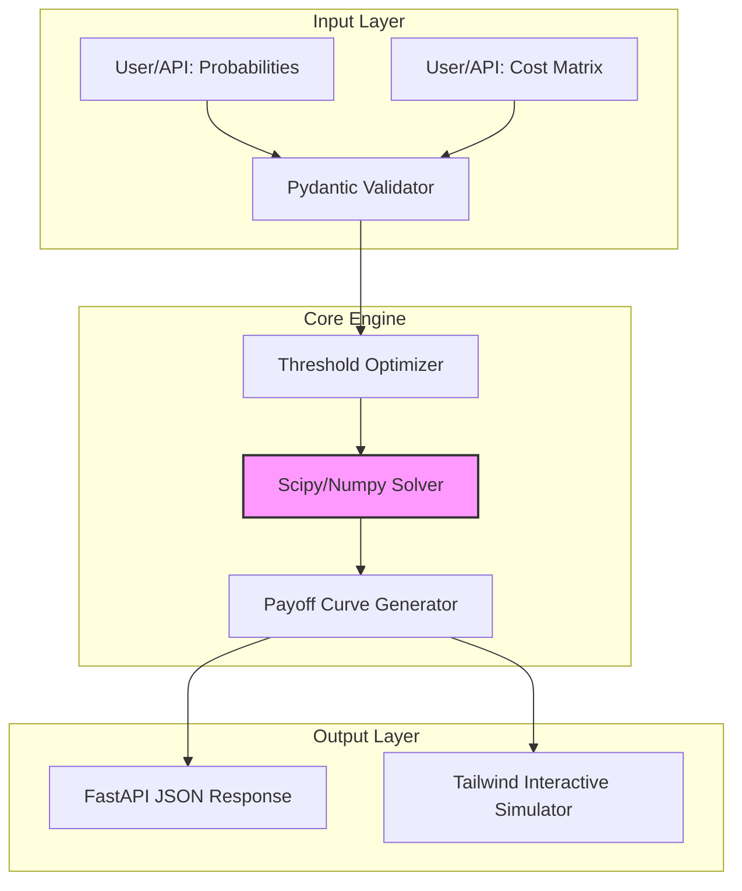

# ARCHITECTURE.md: CostBenefit Optimizer

## 1. High-Level System Topology
The system operates as a stateless computational engine that maps probabilistic model outputs ($P$) to expected monetary value ($EMV$) through a transformation layer defined by a Cost-Benefit Matrix ($C$).



## 2. Tech Stack Rationale
*   **Python 3.11+**: Leverages `TaskGroup` for concurrent matrix processing and `Self` type hinting for fluent API chaining.
*   **Pydantic v2**: Critical for runtime schema enforcement of cost matrices; utilizes Rust-based validation for high-throughput serialization.
*   **Scipy/Numpy**: Vectorized operations for calculating the objective function $f(t) = \sum (P_i \cdot C_{ij})$. Essential for $O(n)$ threshold sweeping.
*   **FastAPI**: Asynchronous request handling with `uvicorn` workers; provides native OpenAPI documentation for the optimization endpoints.
*   **Tailwind/Alpine.js**: Frontend stack for the simulator; chosen for zero-build-step interactivity and high-performance DOM manipulation without heavy framework overhead.

## 3. Module & Directory Layout
```text
/src
├── core/
│   ├── optimizer.py      # Vectorized threshold optimization logic
│   ├── matrix.py         # Cost-Benefit Matrix validation & transformation
│   └── calculator.py     # Expected Value (EV) computation engine
├── api/
│   ├── routes.py         # FastAPI endpoints
│   └── schemas.py        # Pydantic models for request/response
├── simulator/
│   ├── static/           # Tailwind/Alpine.js assets
│   └── templates/        # Jinja2 interactive dashboard
├── utils/
│   └── math.py           # Numerical stability helpers
└── main.py               # Application entry point
```

## 4. Data Flow & Component Interaction
1.  **Ingestion**: The `api/routes.py` receives a payload containing a probability distribution (array) and a $2 \times 2$ (or $N \times N$) cost matrix.
2.  **Validation**: `Pydantic` ensures the matrix is non-singular and probabilities are normalized $[0, 1]$.
3.  **Optimization**: 
    *   The `optimizer` generates a range of thresholds $T \in [0, 1]$.
    *   For each $t$, the system computes the confusion matrix: $TP, FP, TN, FN$.
    *   The `calculator` applies the cost matrix: $EMV(t) = (TP \cdot C_{tp}) + (FP \cdot C_{fp}) + (TN \cdot C_{tn}) + (FN \cdot C_{fn})$.
4.  **Resolution**: The system identifies the global maximum of the $EMV$ curve and returns the optimal threshold $t^*$ and the projected ROI.

## 5. Security & Boundary Isolation
*   **Input Sanitization**: All incoming matrices are subjected to strict range checks to prevent division-by-zero or overflow errors in the `Scipy` solver.
*   **Memory Constraints**: The `optimizer` implements a hard limit on the number of probability points (default $10^5$) to prevent DoS via memory exhaustion.
*   **Execution Isolation**: The computational engine is decoupled from the I/O layer. The `calculator` is a pure function, ensuring no side effects and facilitating unit testing with deterministic inputs.
*   **Dependency Pinning**: All numerical dependencies (`numpy`, `scipy`) are pinned to specific versions to prevent non-deterministic behavior in floating-point arithmetic across environments.